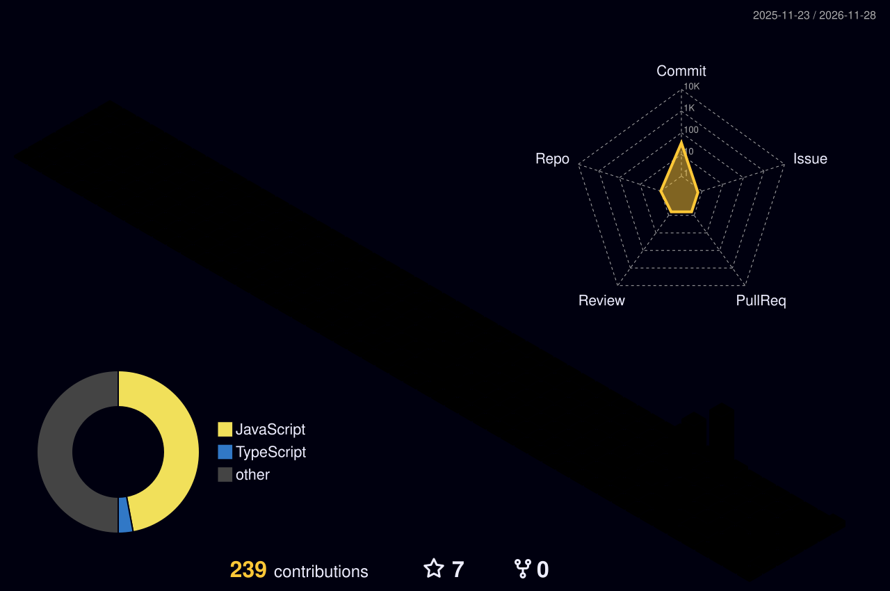

  

  
  
  

---

<h2><code>> about</code></h2>

    I'm a Software Engineer focused on building practical software systems,
    solving engineering problems, and developing technology-driven products.

    My primary interests span trading systems, algorithmic logic, and
    frontend engineering, alongside backend development, API integrations,
    and deployment infrastructure.

    Currently: Co-Founder at MarzTech · Software Developer at EliteScope

I enjoy working beyond the user interface — understanding application architecture, trading execution workflows, system reliability, and the engineering decisions that make software work.

---

<h2><code>> focus</code></h2>

<table>
  <tr>
    <td valign="top" width="50%">

**Trading Systems** — Algorithmic logic, strategy implementation, execution workflows, and risk management.

**Frontend Engineering** — Responsive interfaces, dashboards, and web application development.

**Backend Development** — Server-side functionality, application logic, and database integration.

  </td>
  <td valign="top" width="50%">

**API Integration** — REST APIs, WebSockets, OAuth 2.0, and external services.

**Infrastructure & DevOps** — Docker, VPS environments, CI/CD pipelines, and deployment workflows.

  </td>
  </tr>
</table>

---

<h2><code>> stack</code></h2>

  

---

<h2><code>> experience</code></h2>

    [ Co-Founder — MarzTech ]
    Contributing to technology solutions and digital product development,
    with a focus on software engineering and implementation.

    [ Software Developer — EliteScope ]
    Collaborative development of trading software and supporting systems.

**Areas of contribution**

- Developing and refining trading algorithms and strategy logic.
- Implementing trading functionality and risk management mechanisms.
- Building and maintaining trading platform interfaces.
- Integrating trading APIs and WebSocket communication.
- Contributing to backend functionality and application integrations.
- Working with Git, GitHub, CI/CD pipelines, and deployment environments.
- Debugging, maintaining, and improving application reliability.

---

<h2><code>> stats</code></h2>

  
  

  

  

---

<h2><code>> activity</code></h2>

  <picture>
    <source media="(prefers-color-scheme: dark)" srcset="https://raw.githubusercontent.com/manuuh117/manuuh117/output/github-contribution-grid-snake-dark.svg">
    <source media="(prefers-color-scheme: light)" srcset="https://raw.githubusercontent.com/manuuh117/manuuh117/output/github-contribution-grid-snake.svg">
    
  </picture>

  

  

---

<h2><code>> interests</code></h2>

  
  
  
  

  
  
  
  

---

  <code>Building systems. Understanding the logic. Engineering solutions.</code>

  <a href="https://enuel.site">enuel.site</a>

